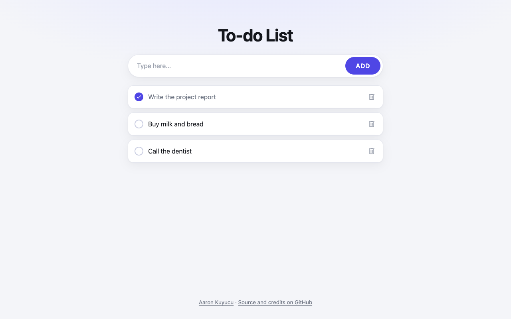

# To-do List

A to-do list in the browser: add tasks, check them off and delete them; the list survives a reload.



## Features

- Add tasks with the button or Enter
- Check off and delete tasks, with a pointer or with the keyboard (Tab, Space, Enter)
- Tasks and their state persist in `localStorage`
- Task text is shown as plain text: `Fix <header>` stays `Fix <header>`
- The layout adapts to narrow screens

## Tech

- HTML, CSS, vanilla JavaScript, no build step and no dependencies
- `localStorage` for persistence
- Material Symbols icons as inline SVG

## How to run

Open the live version: **[aaronkuy.github.io/to-do-list](https://aaronkuy.github.io/to-do-list/)**

Or run it locally:

```bash
git clone https://github.com/aaronkuy/to-do-list.git
cd to-do-list
open index.html        # macOS; on Linux use xdg-open, on Windows start
```

## How it works

- `index.html` contains a `<template>` for one list item. `script.js` clones it and sets the task text with `textContent`, so user input is never parsed as HTML.
- State is one array in memory. Every task gets an id for the current page view; the list has one `change` and one `click` listener and finds the task through that id.
- The checkbox is invisible but still in the page, on top of the drawn circle, so it can be focused and toggled with the keyboard. After a delete, focus moves to a neighbouring task or back to the input.
- `storage.js` reads and writes the list. Stored data that is not a list of tasks is ignored with a console warning instead of breaking the page. The storage key is `to-do-list:todos`; tasks saved under the earlier key `todos` are carried over once.

## Tests

```bash
node --test        # or: npm test
```

- `test/storage.test.js` (10 tests) covers `storage.js`: loading, validation, the key carry-over and blocked storage.
- `test/page-load.test.js` (3 tests) runs `storage.js` and `script.js` together against a small stand-in for the DOM and checks that opening the page shows the stored tasks without rewriting them, also after the key carry-over and with unreadable data.

The tests need Node.js 20 or newer and nothing else. Keyboard use, focus and the layout are not covered by automated tests.

## Limitations

- Tasks live only in this browser's `localStorage`; there is no sync and no export.
- Two open tabs do not update each other; the tab that saves last wins.
- If saving fails (storage blocked or full) there is only a console warning, no message on the page.
- Tasks cannot be edited or filtered.
- Some colours are below WCAG contrast recommendations (placeholder, delete icon, checkbox border), and the delete button is smaller than 44 px.

## Credits

- The first version of `script.js` (one array as state, a list rendered from it, save and load through `localStorage`) started from a to-do list tutorial. The link to that tutorial is not recorded in this repository yet.
- Icons: "check" and "delete" from [Material Symbols](https://fonts.google.com/icons) by Google, embedded as inline SVG and licensed under the [Apache License 2.0](https://www.apache.org/licenses/LICENSE-2.0).

## License

MIT, see [LICENSE](LICENSE). It covers what this repository adds; the tutorial approach and the icons remain under the terms of their sources (see Credits).
