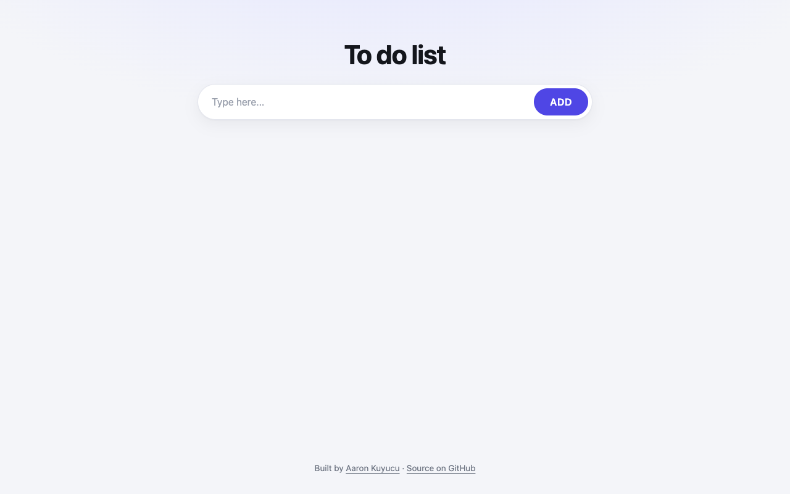

# To-do List

A to-do list in the browser: add tasks, check them off and delete them; the list survives a reload.



## Features

- Add tasks with the button or Enter
- Check off and delete tasks
- Tasks and their state persist in `localStorage`
- Works on phone screens

## Tech

- HTML, CSS, vanilla JavaScript
- `localStorage` for persistence
- Material Symbols icons as inline SVG

## How to run

Open the live version: **[aaronkuy.github.io/to-do-list](https://aaronkuy.github.io/to-do-list/)**

Or run it locally. There is no build step and no dependency:

```bash
git clone https://github.com/aaronkuy/to-do-list.git
cd to-do-list
open index.html        # macOS; on Linux use xdg-open, on Windows start
```

## What I learned

- Rendering a list from an array and keeping it in sync with storage
- Preventing the default form submit
- Responsive CSS for small screens

## What I'd do next

- Edit a task in place
- Filter by open and done
- Build list items with DOM methods instead of `innerHTML`

## License

See [LICENSE](LICENSE).
